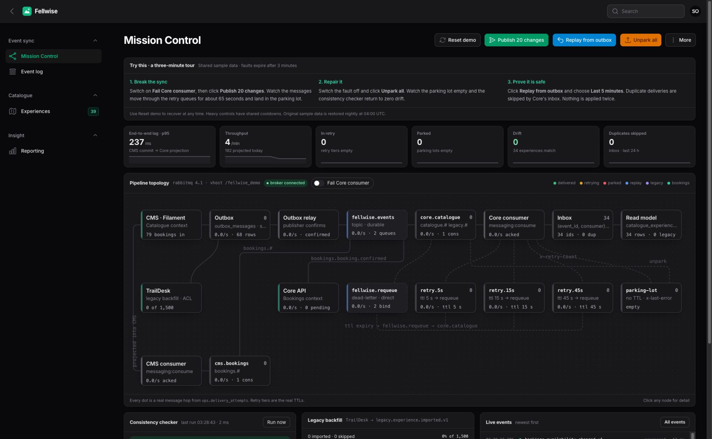
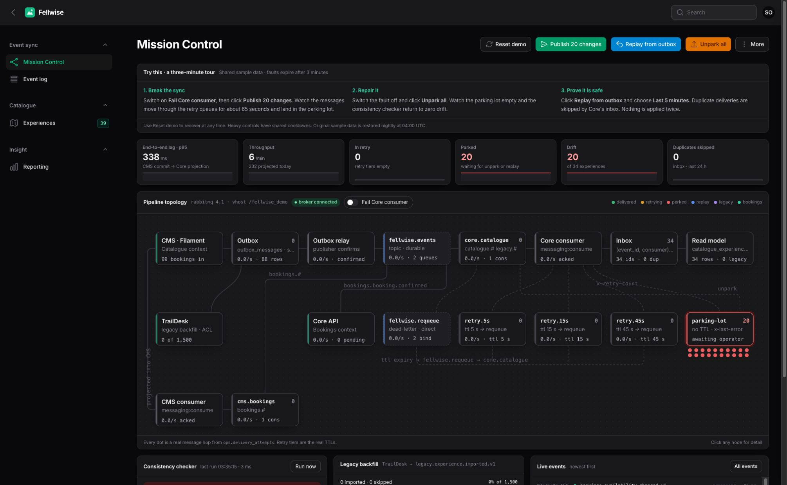
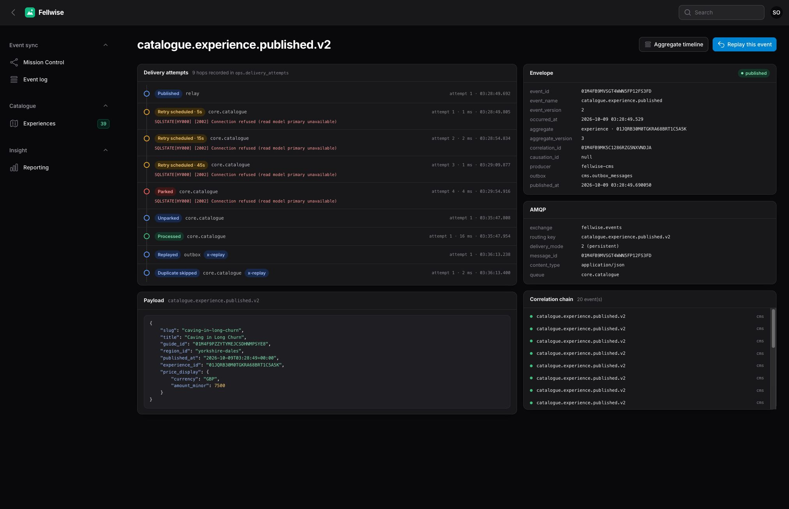

# Fellwise

Fellwise is an outdoor-experiences marketplace demo, built with Laravel and Filament. It uses RabbitMQ events to keep catalogue and booking data in sync.

An editor changes a listing and presses Save. When does the booking system see the same thing?

Catalogue editing and bookings have their own data. A saved change still needs to reach the other side, even if a service is down, a message arrives twice or an older update turns up late. Fellwise makes that journey visible.

[Try the demo](https://fellwise.davidmansaray.com) · [Local setup and operator guide](backend/README.md)



## Saved is one step. Delivered is another.

For the editor, publishing a listing should be uneventful. For the person looking after the system, a successful save is only part of the picture.

Mission Control shows what is waiting, what has failed and whether the catalogue and booking system agree. Recovery controls sit beside that evidence: inspect the failed event, repair the fault, then put the work back through the pipeline.

A retry should not mean another booking-side update. The consumer recognises events it has already applied, and version checks stop late changes from overwriting newer ones. Those rules make replay a useful recovery tool.

## Try breaking the connection

Choose **View demo** to enter the shared sample workspace without signing up.

1. Turn on **Fail Core consumer**, then choose **Publish 20 changes**. Watch retries build up, messages reach the parking lot and the consistency checker report drift.
2. Turn the fault off and choose **Unpark all**. Follow the backlog as the catalogue and booking side catch up.
3. Choose **Replay from outbox**. The same events return; the inbox recognises them and skips work it has already applied.
4. Open an event to inspect its delivery attempts and errors. Then explore reporting, including the SQL and `EXPLAIN` behind the figures.

The hosted demo uses shared sample data. Its public-demo fault controls expire after three minutes. The demo lets you inspect the design and its recovery behaviour.

| Work waiting to recover | The history of one event |
|---|---|
|  |  |

## How it works

Laravel and Filament provide the editing and operations interface, RabbitMQ carries domain events, and MySQL holds the data. Catalogue and Bookings are separate bounded contexts in one Laravel codebase, with separate schemas. Neither reads the other's tables.

The catalogue change and outbox event commit in one transaction. A relay publishes the event and waits for broker confirmation. On the booking side, the inbox claim and projection update commit together before the consumer acknowledges delivery.

Retry queues lead to a parking lot, version checks protect ordering, and sync hashes reveal drift. The same event pipeline also supports a migration from the sample legacy TrailDesk platform. Reporting uses dedicated read models over synthetic historical bookings.

The [backend guide](backend/README.md) covers the pipeline, repository layout and operator commands. The [architecture decisions](backend/docs/adr/) explain the trade-offs around context boundaries, delivery, migration and reporting.

## Running it locally

Requirements: PHP 8.4+ (`sockets`, `pdo_mysql`, `pcntl`), MySQL 8+, Node, and Docker for RabbitMQ.

```bash
cd backend
composer install && npm install && npm run build
cp .env.example .env && php artisan key:generate        # set DB_* and RABBITMQ_*
for db in fellwise_cms fellwise_core fellwise_ops; do mysql -uroot -e "CREATE DATABASE $db"; done
RABBITMQ_PASS=change-me docker compose -f infra/rabbitmq/docker-compose.yml up -d

php artisan fellwise:install --force   # schemas, seed data through the real pipeline, 18 months of bookings
composer workers                       # relay, both consumers, consistency checker, booking traffic
php artisan serve
```

Sign in as `ops@fellwise.co.uk` / `fellwise`.

## Quality

From `backend`:

```bash
composer quality   # Pint, PHPStan level 8, Deptrac
php artisan test   # unit, feature and contract tests
```

A separate `broker` test group runs against a real RabbitMQ vhost to prove the retry topology, unparking and publisher confirms. `bitbucket-pipelines.yml` runs quality and tests in parallel against MySQL and RabbitMQ service containers.

## Further reading

- [`backend/README.md`](backend/README.md): full walkthrough, operator commands and the guarantees table
- [`backend/docs/adr/`](backend/docs/adr/): 001 one repo, two bounded contexts · 002 outbox and inbox · 003 retry topology and parking lot · 004 strangler-fig migration · 005 CQRS read models
